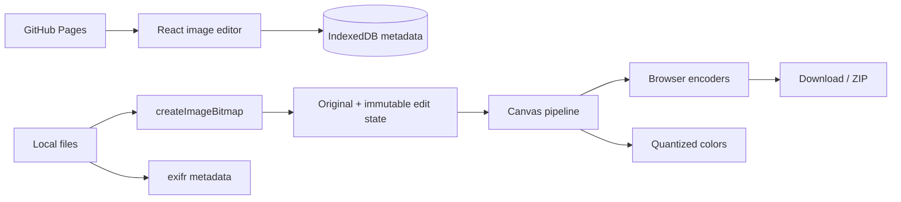

# Image Toolkit Architecture

## Product and FE design

Audience: users preparing web images without uploading originals. First screen: image workspace. A real canvas preview, compact controls, source queue, and explicit exports support repeated work. Rose commands, neutral checkerboard previews, local typography, Lucide icons/tooltips, desktop rail/mobile drawer, and reduced-motion support follow the suite design.

## HLD

No HTTP/backend storage service exists. Browser decode/render/encode is the local backend. Image processing runs on the main thread with bounded, sequential batch encoding, not a high-volume server. Compressed sources can occupy much more memory after decoding.

## LLD

| Module | Ownership |
| --- | --- |
| `src/Workbench.tsx` | Source lifecycle, selection, edit timeline, preview, export/analysis |
| `src/engine.ts` | Geometry validation, decode, transform, codecs, palette, contact sheet |
| `src/Shell.tsx` | Discovery/navigation, favorites/history |
| `src/storage.ts` | Metadata-only persistence |
| `src/theme.css` | Image-specific visual accents |

Source: `{id,file,bitmap,url}`. Import is all-or-nothing; failed additions release decoded bitmaps/URLs. Removal/unmount releases resources. Originals are immutable. Edit state: `{past,present,future}` with 50 prior snapshots. Control edits append a snapshot and clear redo; undo/redo move snapshots. Switching tools retains the pipeline.

Preview is briefly debounced, but export always recomputes from originals at full resolution. Original/edited toggle does not affect export. Crops use source coordinates. Aspect locking derives size from the controlling width/height. Height edits clear explicit width when locked. Batch export uses unique numbered filenames and fails on incompatible geometry. Contact sheets fit unedited originals.

## BE contract

`dimensions(w,h,edit)` validates crop/allocation geometry. `decode(file): Promise<ImageBitmap>` checks MIME/size and codec. `render(bitmap,edit,canvas?): HTMLCanvasElement` applies crop -> resize -> rotate/mirror -> filters/pixelation -> watermark. `encode(canvas,MIME,quality): Promise<Blob>` verifies actual MIME. `contactSheet(sources,columns,tileSize,color): Promise<Blob>` creates a bounded fitted grid. `paletteFromPixels(RGBA)` ignores mostly transparent pixels and ranks coarse bins.

Limits: 30 MB/file, 24 files/150 MB, 16MP, 8192px output side. Browser encoders control output fidelity; PNG has no lossy quality. Canvas exports omit source EXIF. No AI/OCR/RAW/animation/color-managed print backend exists.

## DB design

Database: `local-tools-Image Toolkit`, version 1.

| Store | Key | Value | Retention |
| --- | --- | --- | --- |
| preferences | `favorites` | Tool ID array | Browser-managed |
| history | UUID | `{id,tool,name,time}` | Last 50 successful exports |

No images/names/EXIF/watermark text/edit snapshots persist. Pruning and insertion are atomic. Same-origin scripts can access browser stores; names do not provide tenant isolation. New schemas require explicit version migration.

## Verification and tradeoffs

Unit tests cover geometry/palette boundaries. Browser tests upload known red/blue pixels, inspect RGBA output, decode exports, check PNG dimensions/JPEG signatures, unzip batches, validate contact sheets, and scan all tool states/accessibility/overflow on desktop/mobile Chromium. Metadata omission is not forensic sanitization; blur/pixelation are not secure redaction. Browser codec/color differences are acknowledged. Large images can block the main thread briefly; no unlimited-volume guarantee is made.